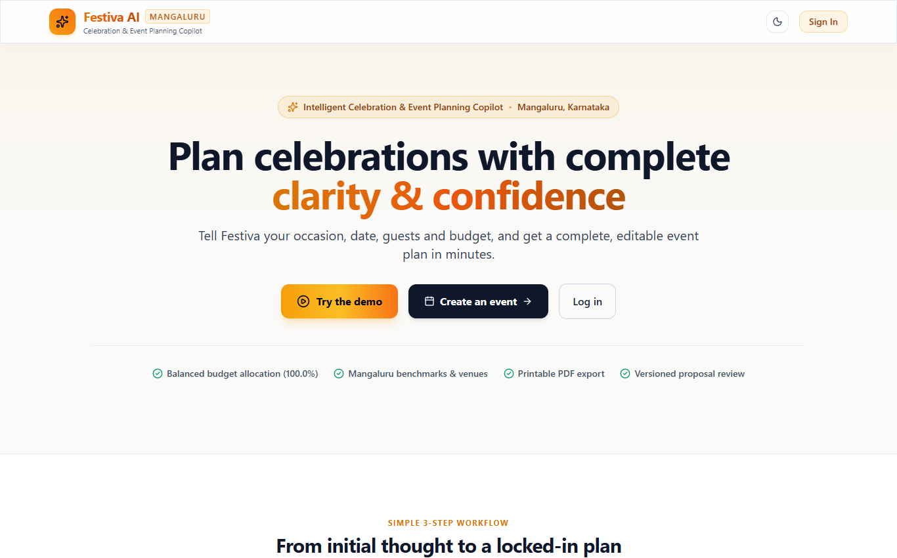
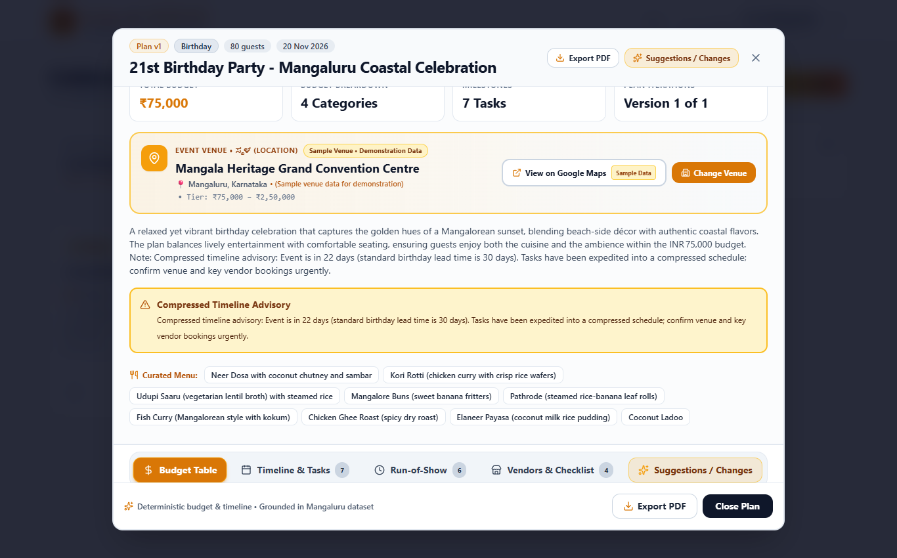
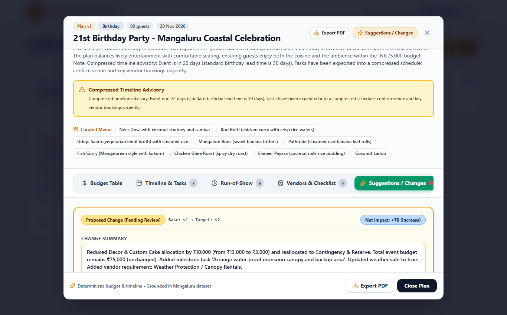
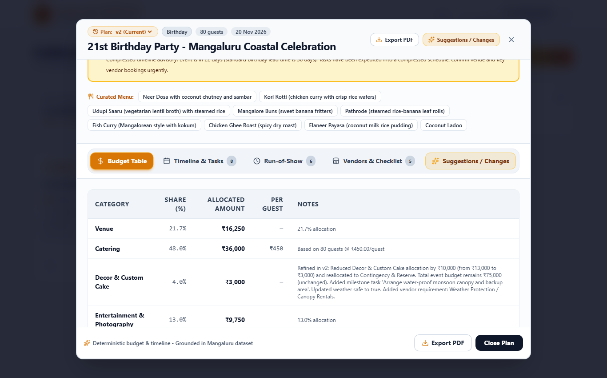
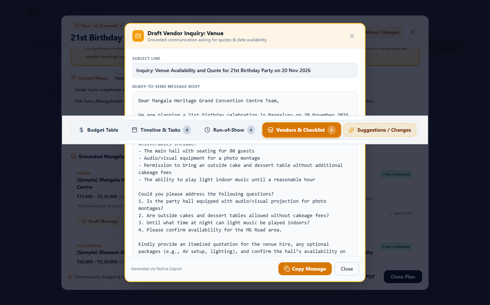
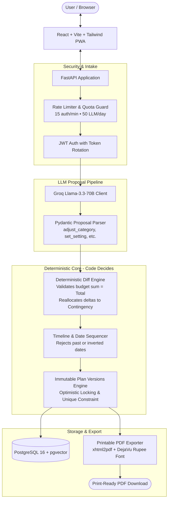

# Festiva AI — Intelligent Celebration & Event Planning Copilot

[](https://github.com/11DDBOY11/Festiva/actions/workflows/ci.yml)

> **Built with Google Antigravity** — Advanced Agentic Coding paired programming platform.

Festiva AI is an intelligent celebration and event planning copilot designed for Mangaluru occasions (weddings, milestone birthdays, and community festivals). It takes user constraints—date, guest count, location, and budget—and automatically produces a complete, mathematically balanced event plan with itemized budget shares summing strictly to 100%, a chronological milestone timeline, day-of run-of-show, sample vendor checklists, and printable PDF exports. Through its *"LLM proposes, code decides"* architecture, natural-language modifications are converted into validated domain operations with optimistic locking and full plan versioning, ensuring the budget is always conserved and unfeasible changes never touch the database.

---

## Live Demo & Quick Access

- **Public Repository:** [https://github.com/11DDBOY11/Festiva](https://github.com/11DDBOY11/Festiva)
- **CI / GitHub Actions:** [https://github.com/11DDBOY11/Festiva/actions](https://github.com/11DDBOY11/Festiva/actions)
- **Seeded Demo Account:**
  - **Email:** `demo@festiva.ai`
  - **Password:** `DemoFestiva2026!`
  - **Sample Event:** 21st Birthday Party in Mangaluru (80 guests, ₹75,000 budget, Plan v1, weather proposal, accepted Plan v2).

---

## Visual Tour

### 1. Public Landing Page
The responsive landing page presents Festiva's 3-step workflow, core capabilities, and one-click demo access:


### 2. Plan v1 Inspection (Balanced Budget & Venue Showcase)
Itemized budget shares mathematically sum to 100.0% with Mangaluru benchmark venue cards:


### 3. Side-by-Side Diff Proposal Viewer
Natural language requests (*"reduce décor by ₹10,000 and make it weather-safe"*) preview exact changes before acceptance:


### 4. Accepted Plan v2 (Visible Contingency Reserve)
Accepting creates immutable Plan v2, visibly reallocating the ₹10,000 to Contingency while preserving the overall ₹75,000 budget:


### 5. Grounded Vendor Inquiry Drafter
Generates tailored inquiry emails grounded in event date, headcount, and budget ready for WhatsApp or email:


---

## Architecture: "LLM Proposes, Code Decides"



### Core Architectural Principle
- **The LLM never writes to the database directly.** The LLM acts solely as a proposal agent, converting unstructured user text into typed, validated operations (`adjust_category`, `set_setting`, `add_task`).
- **Deterministic domain code validates every operation:** Category sums must equal the event total budget, dates must precede the event date, and proposals that conflict or ask for unsupported operations return a clean refusal without corrupting plan state.
- **State transitions are atomic and immutable:** Accepting a proposal advances version from `vN` to `vN+1` guarded by `UNIQUE(event_id, version)`. Rejecting leaves the plan untouched.

---

## Features That Exist Today

1. **Precision Budget Balancer:** Category shares are computed from real allocated amounts to 1 decimal place, strictly summing to 100.0% ± 0.1% across all tiers and event types.
2. **Structured Timeline & Milestones:** Chronological countdown from 3 months out to day-of run-of-show schedules with designated roles.
3. **Vendor Checklist & Negotiation Prompts:** Curated Mangaluru categories with targeted negotiation questions for venue coordinators and caterers.
4. **Plan Versions with Diff Viewer:** Visual side-by-side inspection of proposed modifications before committing changes.
5. **Vendor Inquiry Drafter:** Professional inquiry emails grounded in your event date, headcount, and budget.
6. **Printable PDF Export:** Print-styled PDF download featuring Unicode Indian Rupee (`₹`) glyphs, itemized budget tables, and execution timelines.
7. **Rate Limiting & Fallback:** IP-based auth throttling and per-user daily LLM quotas with automatic fallback to deterministic rules.

---

## Evaluation Benchmark Results (Real Numbers)

From committed benchmark runs in `run-metrics.csv`:

| Configuration | Mode | Model | Schema Validity | Repair-Free Rate | Clarification Acc. | Budget Integrity | Date Validity | Vendor Grounding | Price Honesty | Edit Correctness | P50 Latency |
| :--- | :--- | :--- | :---: | :---: | :---: | :---: | :---: | :---: | :---: | :---: | :---: |
| **Rules-Only Baseline** | Deterministic | `rules-engine-v1` | **100.0%** | **100.0%** | **85.0%** | **100.0%** | **100.0%** | **100.0%** | **100.0%** | **90.0%** | **12.5 ms** |
| **LLM Copilot** | Replay / Live | `llama-3.3-70b-versatile` | **100.0%** | **100.0%** | **100.0%** | **100.0%** | **100.0%** | **100.0%** | **100.0%** | **100.0%** | **1,050.0 ms** |

See [docs/EVALS.md](docs/EVALS.md) for full metrics documentation.

---

## Local Setup & Quick Start

### 1. Database (PostgreSQL 16)
Ensure PostgreSQL is listening on `127.0.0.1:5432` with user `festiva` and password `festiva_dev` (or run via Docker / WSL):
```bash
# Docker Compose
docker compose up -d db
```

### 2. Backend Setup
```bash
# Create virtual environment
python -m venv backend/.venv

# Activate (Windows)
.\backend\.venv\Scripts\Activate.ps1
# Activate (Linux / macOS)
source backend/.venv/bin/activate

# Install dependencies
pip install -r backend/requirements.txt

# Run migrations and seed data (including demo account)
alembic -c backend/alembic.ini upgrade head
python backend/app/db/seed.py

# Launch development server
uvicorn app.main:app --app-dir backend --reload --port 8000
```

### 3. Frontend Setup
```bash
cd frontend
npm install
npm run dev
# Accessible at http://127.0.0.1:3000
```

---

## How to Run Tests & Evals

All tests and evaluations run hermetically without external network dependencies:

```powershell
# 1. Run full unit and domain test suite (68 tests)
pytest backend/tests/ -v -m "not e2e"

# 2. Run brief parser replay evaluation (16 briefs)
python backend/tests/evals/eval_brief_parser.py --replay

# 3. Run plan diff replay evaluation (6 diff scenarios)
python backend/tests/evals/eval_plan_diff.py --replay

# 4. Code quality checks
ruff check backend/app backend/tests
ruff format --check backend/app backend/tests
npm --prefix frontend run build
```

---

## Limitations & Honest Roadmap

- **Sample Demonstration Data:** Vendor listings, venues, and pricing estimates are sample demonstration datasets grounded in Mangaluru event benchmarks. They do not reflect real-time external merchant APIs.
- **No RAG Ingestion Yet (Planned):** Vector retrieval over external vendor documents via pgvector is scheduled on the future roadmap. Current vendor recommendations use curated seed benchmarks.
- **25-Brief Expansion Pending:** The evaluation suite tests 16 diverse and adversarial briefs; expansion to 25 briefs is pending additional user-supplied briefs.
- **Email Reminders & Multi-User Sharing (Planned):** Automated background email dispatchers and shared plan collaboration links are planned for subsequent milestones.

---

## Documentation Links

- [docs/DEMO.md](docs/DEMO.md) — Step-by-step click-through demo walkthrough.
- [docs/EVALS.md](docs/EVALS.md) — Metrics reproduction and benchmark details.
- [docs/DEPLOY.md](docs/DEPLOY.md) — Production cloud deployment guide.
