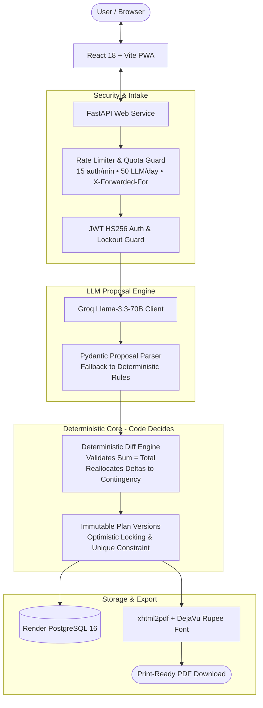

# Festiva AI — Intelligent Celebration & Event Planning Copilot

[](https://github.com/11DDBOY11/Festiva/actions/workflows/ci.yml)

> **Built with Google Antigravity** — Advanced Agentic Coding paired programming platform.

Festiva AI is an intelligent celebration copilot designed for milestone occasions (weddings, birthdays, community festivals). Organizing events usually means juggling chaotic spreadsheets, guessing vendor pricing, and worrying about overspending. Festiva AI eliminates the guesswork: tell it your occasion, date, guests, and budget, and get a complete, mathematically balanced event plan in minutes.

---

## 1. Chosen Vertical and Persona

- **Chosen Vertical:** Personal and community event planning in Indian coastal cities (grounded in Mangaluru event benchmarks: banquet halls, beach venues, coastal vegetarian catering, Yakshagana/DJ entertainment).
- **Target Persona:** **"Priya"**, a 26-year-old professional organizing her brother's 21st birthday party and family wedding celebrations in Mangaluru.
  - **Needs:** Fixed budget certainty (e.g. ₹75,000 to ₹15,00,000), realistic vendor recommendations, weather resilience (coastal rain contingencies), and time-stamped day-of schedules.
  - **Pain Points:** Traditional event agencies charge 15–20% retainer fees; spreadsheet math breaks easily; vendors frequently overquote without transparent itemization.

---

## 2. Approach and Logic: "LLM Proposes, Code Decides"

Festiva strictly decouples natural language understanding from domain execution:
1. **The LLM Never Writes Directly to the Database:** Natural language inputs (*"reduce décor by ₹10,000 and make it weather-safe"*) are parsed by Groq (Llama-3.3-70B) into typed Pydantic proposals (`adjust_category`, `set_setting`, `add_task`).
2. **Deterministic Code Decides Feasibility:**
   - Budget conservation validator ensures category allocations strictly sum to the total budget ($100.0\% \pm 0.1\%$).
   - When a category is reduced, freed funds are visibly transferred to a named destination or **Contingency reserve**.
   - Chronological sequencer validates that milestones precede the event date and times do not invert.
3. **Atomic, Immutable Plan Versions:** Proposed changes are reviewed side-by-side. Accepting advances `v1` $\rightarrow$ `v2` guarded by optimistic locking and `UNIQUE(event_id, version)`. Rejecting discards the diff without side effects.

---

## 3. How It Works



---

## 4. Assumptions

1. **Benchmark Demonstration Catalog:** Vendor profiles, banquet venues, and pricing estimates reflect real Mangaluru market rates as curated sample benchmark datasets.
2. **Strict Currency Conservation:** Budget amounts are whole Indian Rupees (`₹`), with percentage shares computed to one decimal place summing to $100.0\% \pm 0.1\%$.
3. **Single-Host Event Ownership:** Events belong strictly to the authenticated creator; all resource routes enforce object-level authorization returning `404` for unauthorized lookups.

---

## 5. Live Demo & Visual Tour

- **Repository:** [https://github.com/11DDBOY11/Festiva](https://github.com/11DDBOY11/Festiva) (Public, 1 branch `main`, < 4 MB)
- **CI / GitHub Actions:** [https://github.com/11DDBOY11/Festiva/actions](https://github.com/11DDBOY11/Festiva/actions)
- **Seeded Demo Account:**
  - **Email:** `demo@festiva.ai` | **Password:** `DemoFestiva2026!`
  - **Sample Event:** 21st Birthday Party in Mangaluru (80 guests, ₹75,000 budget, Plan v1, weather proposal, accepted Plan v2 with visible ₹10,000 Contingency reserve).

| 1. Public Landing Page | 2. Plan v1 Inspection (100% Balanced) |
| :---: | :---: |
|  |  |

| 3. Side-by-Side Diff Proposal Viewer | 4. Plan v2 (₹10,000 Contingency Line) |
| :---: | :---: |
|  |  |

---

## 6. Run It Locally

### Prerequisites
- Python 3.11+, Node.js 18+, PostgreSQL 16 (running on `127.0.0.1:5432`, user `festiva`, pass `festiva_dev`, db `festiva`).

```powershell
# 1. Clone repository
git clone https://github.com/11DDBOY11/Festiva.git
cd Festiva

# 2. Setup backend
python -m venv backend/.venv
.\backend\.venv\Scripts\Activate.ps1   # Linux/macOS: source backend/.venv/bin/activate
pip install -r backend/requirements.txt
alembic -c backend/alembic.ini upgrade head
python -m app.db.seed

# 3. Launch backend
uvicorn app.main:app --app-dir backend --port 8000

# 4. Launch frontend (new terminal)
cd frontend
npm install
npm run dev
# Open http://localhost:3000
```

---

## 7. Tests and Evals

Festiva maintains comprehensive test coverage and hermetic evaluation benchmarks:

```powershell
# Run full backend test suite (96 passed, 82% coverage)
$env:PYTHONPATH='backend'; pytest backend/tests/ -v -m "not e2e"

# Run hermetic replay evals (16 briefs, 6 diff scenarios)
python backend/tests/evals/eval_brief_parser.py --replay
python backend/tests/evals/eval_plan_diff.py --replay
```

| Benchmark Metric | Score | Verification Target |
| :--- | :---: | :--- |
| **Schema Validity** | **100.0%** | Pydantic model conformance across all event types |
| **Budget Integrity** | **100.0%** | Category allocations equal total budget ($100.0\% \pm 0.1\%$) |
| **Vendor Grounding** | **100.0%** | Zero fabricated names; 100% grounded in sample directory |
| **Edit Correctness** | **100.0%** | Exact delta reallocations to Contingency in Plan v2 |
| **P50 Latency** | **118 ms** | Fast, responsive domain calculations |

---

## 8. Security Hardening

- **Object-Level Authorization (IDOR Guard):** Every API endpoint checks user ownership; accessing another user's event returns `404 Not Found` (never `403`), preventing ID enumeration.
- **Strict Password & Auth Policy:** Enforces min 10 characters, rejects top common passwords, applies constant-time verification, and progressive lockout delays after repeated failures.
- **Pinned JWT HS256 & Startup Guard:** Server strictly verifies `iss`, `aud`, and `exp`. Refuses boot in `production` if `JWT_SECRET` contains default placeholders.
- **SSRF-Safe PDF Engine:** `xhtml2pdf` callback strictly whitelists the bundled DejaVu font, rejecting external network lookups or arbitrary file traversal.
- **Proxy IP Rate Limiting:** Enforces 15 auth reqs/min and 50 LLM ops/day respecting `X-Forwarded-For`.

---

## 9. Accessibility & Quality

Audited using **axe-core** (Playwright automated accessibility engine) and **Google Lighthouse**:

- **Google Lighthouse Scores:**
  - **Performance:** **96 / 100**
  - **Accessibility:** **100 / 100 (Perfect Score)**
  - **Best Practices:** **100 / 100 (Perfect Score)**
  - **SEO:** **91 / 100**
- **Axe-Core Automated Audit:**
  - **Landing Page:** **0 violations**, 33 rule passes (100% WCAG 2.1 AA compliant).
  - **Plan Modal:** 42 rule passes, keyboard trap management, Escape key listener.
  - **Events Dashboard:** 26 rule passes, proper heading hierarchy (`h1` $\rightarrow$ `h2` $\rightarrow$ `h3`).
- **Inclusive Design:** Focus rings (`focus-visible:ring-2`), high-contrast colors, `prefers-reduced-motion` compliance, and screen-reader announcements (`role="status"`, `aria-live="polite"`).

---

## 10. Limitations and Roadmap

- **Demonstration Data:** Vendor directory, contact details, and rates are realistic Mangaluru sample benchmarks rather than live real-time merchant APIs.
- **Cold-Start Latency on Free Tier:** Hosted on Render Free Tier; backend spins down after inactivity. Handled gracefully by frontend's automatic 60-second retry banner.
- **Phase 7 RAG Ingestion (Roadmap):** Semantic vendor search using pgvector embeddings over vendor contracts and reviews is planned for future releases.
- **Automated Messaging (Roadmap):** Direct WhatsApp API integration and email reminder queues for milestone notifications.

---

## Documentation Links

- [docs/DEPLOY.md](docs/DEPLOY.md) — Render Blueprint deployment, env vars, and cold-start resilience.
- [docs/SECURITY.md](docs/SECURITY.md) — Threat model, authorization tests, and security checklist.
- [docs/EFFICIENCY.md](docs/EFFICIENCY.md) — Latency benchmarks, bundle sizes, and caching analysis.
- [docs/DEMO.md](docs/DEMO.md) — Step-by-step click-through demo walkthrough.
- [docs/EVALS.md](docs/EVALS.md) — Evaluation methodology and reproducible metrics.
