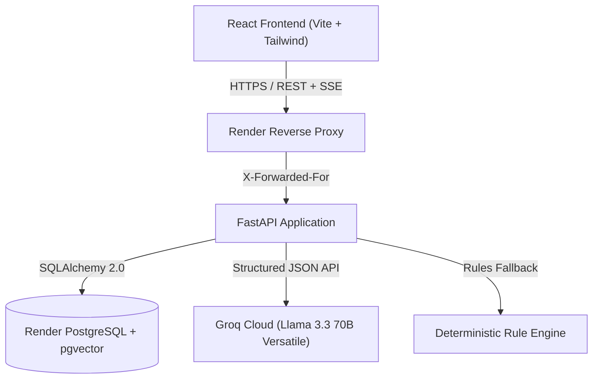

# Festiva AI Architecture

Festiva AI is an autonomous, localized event planning assistant designed for celebrations in Mangaluru, India (Weddings, Milestone Birthdays, and Community Celebrations).

## System Components

### 1. Frontend Layer (`frontend/`)
- **Technology**: React 18, Vite, Tailwind CSS, TypeScript.
- **State Management & Logic**: Modular custom hooks:
  - `useEvents`: Manages event listings, brief creation modal state, brief parsing, and deletion.
  - `usePlanModal`: Manages tabbed plan views (Budget, Timeline, Run-of-Show, Vendors, Refine/Chat), optimistic lock rebasing, diff review, and SSE streaming chat.
- **Component Hierarchy**:
  - `PlanViewModal.tsx`: Coordinator rendering isolated tab panels (`BudgetTabPanel`, `TimelineTabPanel`, `RunOfShowTabPanel`, `VendorsTabPanel`, `RefineTabPanel`).
  - `EventsPage.tsx`: Coordinator delegating to `EventsHeader`, `EventCard`, and `CreateEventModal`.

### 2. Backend Services Layer (`backend/app/services/`)
Separates HTTP endpoint routing from business operations:
- `event_service`: Handles event persistence, listing, creation, and strict tenant ownership verification (`get_user_event`).
- `plan_service`: Generates initial plans via LLM/rules fallback, manages version history (v1..vN), and compiles ReportLab PDF exports.
- `change_service`: Coordinates plan refinement, optimistic lock rebasing, change proposals, change acceptance (atomic increment from vN to vN+1), change rejection, and SSE chat streaming.
- `vendor_service`: Crafts localized vendor inquiry drafts grounded in real vendor catalog metadata.

### 3. Domain Engine (`backend/app/domain/`)
- **Diff & Refinement Subpackage (`domain/diff/`)**:
  - `schemas`: Pydantic models for allowed plan operations (`adjust_category`, `set_total_budget`, `add_task`, `remove_task`, `add_vendor_category`, `set_setting`) and structured diffs (`PlanDiff`, `CategoryDelta`, `TimelineDelta`).
  - `extractor`: Heuristic regex parser for monetary deltas and fuzzy category matching.
  - `generator`: Translates free-form natural language prompts into validated diffs using Groq LLM with deterministic fallbacks.
  - `applier`: Applies validated diffs to existing plans with strict domain checks (budget balance, chronological ordering, vendor grounding, price honesty).
- **Vendor Directory**: Curated catalog of fictional sample vendors in Mangaluru with realistic service tiers and contact guidelines.

### 4. Security & Hardening Architecture
- **Object-Level Authorization**: Every route resolves resources scoped strictly to `user.id`. Requests for other users' resources return `404 Not Found` (never `403`) to eliminate resource enumeration.
- **Authentication**: JWT access tokens (short 15-minute TTL) kept in memory; secure refresh tokens rotated on each refresh.
- **Proxy-Aware Rate Limiting**: Client IP extracted securely from the trusted hop via `TRUSTED_PROXY_HOPS` to prevent IP spoofing through fake `X-Forwarded-For` headers.
- **Comprehensive Headers**: HSTS, Content-Security-Policy (CSP), X-Frame-Options, X-Content-Type-Options, Referrer-Policy, and Permissions-Policy configured across backend and frontend static sites.
