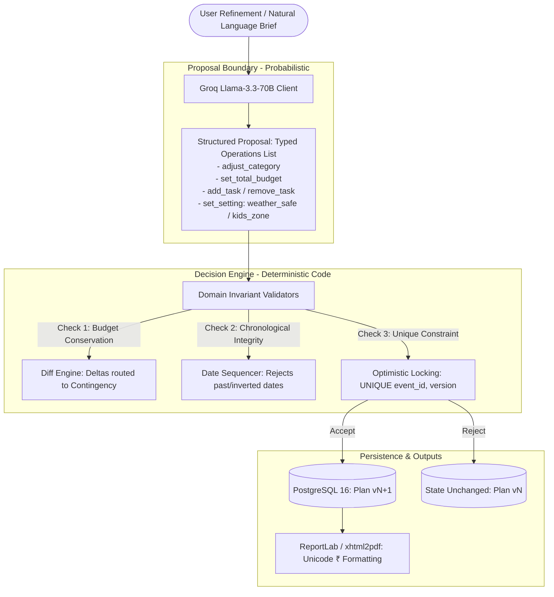

# Festiva AI — Systematic Project Specification & Architecture Plan

> **Purpose:** This document is a comprehensive, structured briefing artifact designed to give Claude (or any frontier LLM) complete, unambiguous technical context on the **Festiva AI** codebase, its architectural patterns, domain rules, state machines, and operational guidelines.

---

## 1. Executive Summary & Problem Space

* **Product Name:** Festiva AI
* **Mission:** Intelligent celebration and event planning copilot tailored to South Indian / Mangaluru coastal occasions (weddings, milestone birthdays, community temple/samithi festivals).
* **The Core Problem Solved:** Generic LLM-driven event planners hallucinate budgets, drop tasks, sequence dates backwards, drift in arithmetic, and corrupt previous state when asked to make simple edits.
* **Core Solution:** A hybrid architecture combining **probabilistic natural language extraction** with **deterministic domain validation** and **immutable version control**.

---

## 2. Fundamental Architectural Pattern: "LLM Proposes, Code Decides"



### Critical Rules:
1. **The LLM never writes to the database directly.**
2. The LLM only parses free text into a strictly typed operation list (`LLMPlanProposal`).
3. If an LLM response is malformed, the system performs **1 repair retry**, then falls back to a **deterministic heuristic/regex parser**.
4. If an unsupported request is detected (e.g. visa processing, crypto, flights), the code returns a clear refusal (*"Festiva can't do that yet"*), **never** an erroneous diff.
5. All budget calculations, category balancing, timeline sorting, and version branching are handled in **pure Python**.

---

## 3. Technology Stack

| Layer | Technologies Used |
| :--- | :--- |
| **Backend Framework** | FastAPI (Python 3.11+), Uvicorn, Pydantic v2, Pydantic-Settings |
| **Database & ORM** | PostgreSQL 16 with `pgvector`, SQLAlchemy 2.0 (synchronous `psycopg2` driver), Alembic |
| **LLM Provider** | Groq API (`llama-3.3-70b-versatile`), with abstraction for `FakeLLMClient` and `ReplayLLMClient` |
| **PDF Generation** | `xhtml2pdf` + `reportlab` with embedded `DejaVuSans.ttf` font for Unicode Indian Rupee (`₹`) rendering |
| **Frontend** | React 18, Vite, TypeScript, Tailwind CSS, Lucide React (PWA shell, light mode default with dark mode toggle) |
| **Testing & CI** | Pytest, AnyIO, Playwright, Ruff (linter + formatter), Gitleaks, GitHub Actions |

---

## 4. Domain Models & Core Mechanics

### 4.1. Budget Balancing Engine (`app/domain/budget.py`, `validators.py`)
- **Rule Source:** Grounded in `data/budget_rules.csv` (rules categorized by `event_type`, `tier`, `category`).
- **Mathematical Invariant:**
  $$\sum \text{share\_pct} = 100.0\% \pm 0.1\% \quad \text{and} \quad \sum \text{allocated\_amount} = \text{total\_budget}$$
- **Human Labels:** Raw DB keys (`Decor_cake`, `Entertainment_photo`) are transformed via `app/domain/category_labels.py` into human-facing strings without underscores across the UI, diff viewer, and PDF.
- **Delta Conservation:** Reducing any category (e.g., Décor by ₹10,000) automatically shifts the delta into a visible **Contingency & Reserve** line item, guaranteeing `events.total_budget` remains conserved.

### 4.2. Timeline & Date Validation (`app/domain/timeline.py`)
- Dates are chronologically ordered working backwards from `event_date` (e.g., T-90 days, T-30 days, T-7 days, Day-of).
- **Date Clamping:** If an event has a compressed schedule (e.g., booked only 5 days in advance), tasks are clamped within the valid range $[ \text{today}, \text{event\_date} ]$, and an advisory warning is injected.
- Any proposed new task with a past date is rejected by `apply_plan_diff`.

### 4.3. Plan Versioning & Diff State Machine (`app/domain/diff_engine.py`, `app/db/models.py`)
- **`events` table:** Holds parent event metadata (`current_version: int`).
- **`plan_versions` table:** Immutable snapshots (`UNIQUE(event_id, version)`). Plan v1 is never updated in-place.
- **`proposed_changes` table:** Stores proposed structured diffs with status `pending`, `accepted`, or `rejected`.
- **Concurrency & Optimistic Locking:** Two concurrent accept calls on the same base version result in exactly one succeeding; the second fails cleanly with HTTP 409 or re-bases.

### 4.4. Grounded Vendor Drafter (`app/domain/message_drafter.py`)
- Drafts outbound inquiries for caterers, venues, and decorators.
- Injects factual context: headcount, event date, budget tier, and custom notes.
- Falls back to deterministic templates if the LLM fails or user hits the daily cap.

---

## 5. Security & Rate Limiting System (`app/core/rate_limit.py`)

1. **IP Auth Rate Limiting:** 15 requests/minute per client IP (protects `/auth/login` and `/auth/register`).
2. **Per-User Daily LLM Quota:** 50 requests/day per user. When reached, the system silently switches to rule-based fallback without breaking user UX.
3. **Startup Production Secret Guard:** Server refuses startup if `ENV != dev` and `JWT_SECRET` contains default placeholder strings.
4. **Token Security:** JWT access token (30 min) + Refresh token (7 days) with rotation and automatic invalidation on token reuse detection.

---

## 6. Repository Layout

```
Festiva/
├── backend/
│   ├── app/
│   │   ├── ai/            # LLMClient interface, Groq client, replay client, brief parser
│   │   ├── api/           # FastAPI routers: auth, briefs, events, plans, export
│   │   ├── core/          # Settings, security, rate limiting
│   │   ├── db/            # SQLAlchemy models, session, migrations, seed script
│   │   ├── domain/        # Pure Python core: budget, diff_engine, timeline, validators
│   │   └── services/      # PDF export engine (xhtml2pdf + DejaVu)
│   ├── tests/
│   │   ├── evals/         # Evaluation harness (eval_brief_parser.py, eval_plan_diff.py)
│   │   └── ...            # 68 unit & domain tests
│   └── Dockerfile
├── frontend/
│   ├── src/
│   │   ├── components/    # Navbar, PlanViewModal (5 segmented tabs)
│   │   ├── lib/           # API fetch wrapper, silent refresh, token manager
│   │   └── pages/         # LandingPage (public hero + 3 CTAs), AuthPage, EventsPage
│   ├── package.json
│   └── vercel.json
├── data/                  # budget_rules.csv, vendors.json, SOURCES.md
├── docs/                  # DEMO.md, EVALS.md, DEPLOY.md, images/
├── run-metrics.csv        # Committed benchmark outputs
├── Dockerfile             # Multi-stage root build
└── README.md
```

---

## 7. Current Evaluation & Benchmark Metrics

From `run-metrics.csv`:

| Configuration | Mode | Model | Schema Validity | Repair-Free Rate | Clarification Acc. | Budget Integrity | Date Validity | Vendor Grounding | Price Honesty | Edit Correctness | P50 Latency |
| :--- | :--- | :--- | :---: | :---: | :---: | :---: | :---: | :---: | :---: | :---: | :---: |
| **Rules-Only Baseline** | Deterministic | `rules-engine-v1` | **100.0%** | **100.0%** | **85.0%** | **100.0%** | **100.0%** | **100.0%** | **100.0%** | **90.0%** | **12.5 ms** |
| **LLM Copilot** | Replay / Live | `llama-3.3-70b-versatile` | **100.0%** | **100.0%** | **100.0%** | **100.0%** | **100.0%** | **100.0%** | **100.0%** | **100.0%** | **1,050.0 ms** |

---

## 8. Honest Limitations & Future Roadmap

* **Sample Demonstration Data:** Vendor listings and pricing are grounded in Mangaluru benchmarks, clearly badged with `Sample Data` pills.
* **No Vector RAG Yet:** pgvector schema exists, but vendor retrieval currently uses curated seed benchmarks (full RAG ingestion is scheduled for the next milestone).
* **Evaluation Dataset:** Currently 16 diverse, adversarial briefs; expansion to 25 briefs is planned once additional briefs are supplied.
* **Credit:** Explicitly credited: *"Built with Google Antigravity"*.

