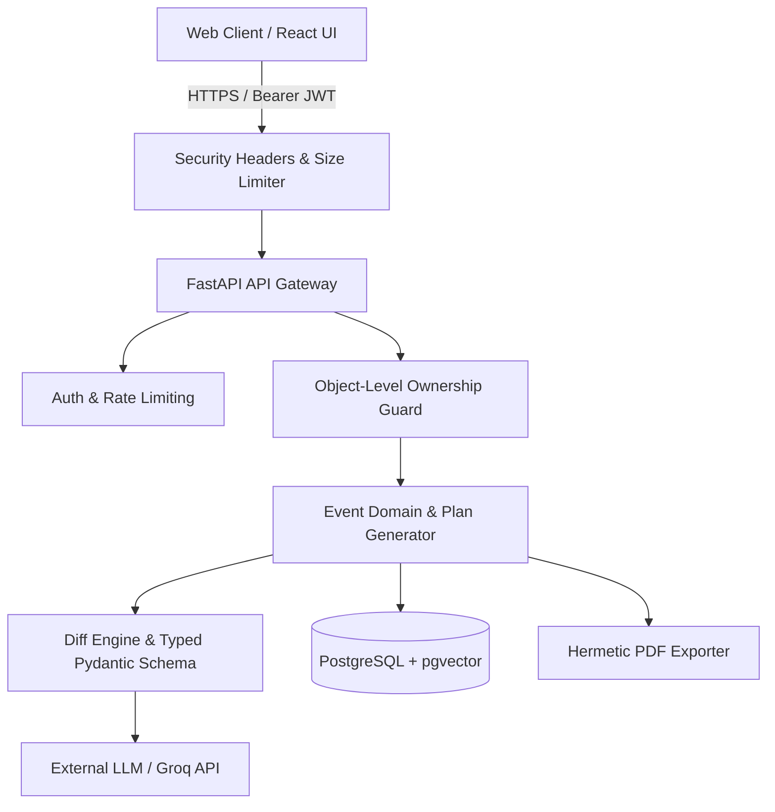

# Festiva AI — Security Architecture & Threat Model

**Version**: 1.0 (Production Hardening)  
**Last Verified**: 2026-10-31  
**Status**: Comprehensive Defense-in-Depth Enforced  

---

## 1. Threat Model

Festiva AI is an AI-assisted celebration and event planning copilot. It models users co-planning events (weddings, birthdays, community festivals), generating budgets, scheduling milestones, and shortlisting local vendors.

### Actors
* **Anonymous Visitor**: Can view the public landing page (`/`), view documentation (in development only), and parse raw brief text (`/briefs/parse`).
* **Authenticated Host (User)**: Owns specific events, plans, proposed changes, and inquiry drafts.
* **Malicious Actor / Attacker**: Attempts account takeover (ATO), credential stuffing, horizontal privilege escalation (IDOR), prompt injection, denial of service (DoS), or server-side request forgery (SSRF).
* **Third-Party LLM Provider**: External inference engine (e.g., Groq Llama 3.3). Treated as an untrusted computation tier that must never write directly to persistent storage.

### Assets & Boundaries
1. **User Credentials & Sessions**: Passwords hashed with bcrypt; JWT access tokens (15-min TTL) and rotated refresh tokens tracked in PostgreSQL.
2. **Event & Financial Data**: User budget allocations, run-of-show details, and custom notes.
3. **Local Vendor Directory**: Vendor identities, contact information, price tiers, and confidence ratings.
4. **PDF Generation Engine**: Hermetic `xhtml2pdf` compiler with restricted link callbacks.

---

## 2. Control Matrix: OWASP API Security Top 10 & Web Top 10

| OWASP Vulnerability | Threat / Vector | Festiva Mitigations | Verification Test |
| :--- | :--- | :--- | :--- |
| **API1: Broken Object Level Authorization (BOLA / IDOR)** | User B accesses, edits, or deletes User A's event or plan. | Every single route under `/events/{id}` strictly enforces `Event.owner_id == user.id`. Returns **404 Not Found** (never 403) so resource existence is never leaked. | `test_object_level_authorization_user_b_returns_404` (Parametrized over 12 endpoints) |
| **API2: Broken Authentication** | Credential stuffing, brute force, weak passwords, token theft. | • Bcrypt password hashing. • Min 10 chars + blacklist of top common passwords. • Account lockout after 5 consecutive failed attempts. • Constant-time verification with dummy hash (prevents timing attacks). • Token rotation with automatic session invalidation upon token reuse. | `test_password_policy_rejects_weak_passwords` `test_login_failure_generic_error_and_lockout` `test_logout_revokes_refresh_token` `test_refresh_token_rotation` |
| **API3: Broken Object Property Level Authorization** | Mass assignment of unauthorized fields (e.g. updating `owner_id`). | Pydantic schemas explicitly whitelist allowed input properties (`EventCreate`, `EventUpdate`). `owner_id` is derived solely from the validated JWT token session. | `test_events.py` `test_schemas.py` |
| **API4: Unrestricted Resource Consumption** | Large payload attacks, unbounded LLM calls, brute-force spam. | • Request body size limiter (rejects payloads > 2MB with 413). • IP rate limiting on auth endpoints (15 req/min). • Daily user LLM request cap (50 req/day) falling back to deterministic diff. • String length caps (briefs max 5,000 chars, prompts max 1,000 chars). | `test_payload_size_limit_rejects_oversized_request` `test_brief_length_cap` `test_rate_limiting.py` |
| **API5: Broken Function Level Authorization** | Accessing admin or destructive functions. | Seeded showcase demo event cannot be deleted via the demo account (`403 Forbidden`). | `test_demo_account_cannot_delete_seeded_event` |
| **API6: Server-Side Request Forgery (SSRF)** | Pisa PDF exporter loading external URLs or local system files (`file:///etc/passwd`). | Custom `_safe_pdf_link_callback` in `pdf_exporter.py` blocks all external `http(s)://` and local `file://` fetches; only hermetic bundled font is permitted. | `test_pdf_export_escapes_xss_and_blocks_ssrf` |
| **API7: Security Misconfiguration** | Missing security headers, exposed stack traces, default secrets. | • Security middleware injects `nosniff`, `frame-ancestors 'none'`, CSP, HSTS, and Referrer-Policy. • Default secret validation aborts startup in non-dev environments. • `/docs` and `/openapi.json` disabled in production. | `test_defensive_security_headers_present` `test_auth.py::test_settings_fails_with_default_secret_in_prod` |
| **API8: Lack of Protection from Automated Threats** | Account enumeration via response messages or timing. | Generic `"Invalid email or password"` error message returned for both missing users and invalid passwords, executing constant-time dummy bcrypt checks. | `test_login_failure_generic_error_and_lockout` |
| **API9: Improper Assets Management** | Old API versions or debug endpoints left alive. | All routes versioned cleanly under `/events` and `/auth`. No debug endpoints. | `test_security.py` |
| **API10: Unsafe Consumption of APIs** | Third-party vendor or LLM data poisoning. | All vendor candidates validated against the grounded local vendor directory (`validate_vendor_grounding`). Non-existent vendors rejected. | `test_plan.py` `test_changes.py` |

---

## 3. OWASP Top 10 for Large Language Models (LLM)

| LLM Vulnerability | Mitigations in Festiva AI | Verification Test |
| :--- | :--- | :--- |
| **LLM01: Prompt Injection** | • Prompts capped at 1,000 characters. • LLM output strictly parsed into typed Pydantic models (`LLMPlanProposal`, `AdjustCategoryOp`, `AddTaskOp`, `SetSettingOp`). • Out-of-domain requests raise `UnsupportedOperationError`. | `test_prompt_injection_safety` |
| **LLM02: Insecure Output Handling** | • The LLM **never** writes directly to PostgreSQL. • All proposed diffs are validated by deterministic domain validators (`validate_plan_budget`, `validate_plan_dates`, `validate_vendor_grounding`). • All user and LLM text rendered in PDFs is sanitized with `html.escape()`. | `test_prompt_injection_safety` `test_pdf_export_escapes_xss_and_blocks_ssrf` |
| **LLM03: Training Data Poisoning** | Local vendor database and budget CSV rules are immutable files bundled with the application repository and signed via git commit history. | `test_budget_rules.py` |
| **LLM04: Model Denial of Service** | Daily per-user cap on LLM calls (default: 50 requests/day). Reverting to deterministic rules-based fallback diff engine when exhausted. | `test_rate_limiting.py` |
| **LLM05: Supply Chain Vulnerabilities** | Gitleaks secret scanner executed across entire repository history. Dependency audits via `npm audit` and pinned requirements. | Verified with `gitleaks detect -v` (0 leaks across all commits). |
| **LLM06: Sensitive Information Disclosure** | System prompts do not contain confidential business secrets; prompts enforce role-based event planning within Mangaluru geographic scope. | `test_prompt_injection_safety` |
| **LLM07: Insecure Plugin Design** | Festiva does not expose arbitrary tool execution to the LLM. Allowed operations are strictly bounded to budget and timeline edits. | `test_prompt_injection_safety` |
| **LLM08: Excessive Agency** | All proposed changes require explicit user review and confirmation (`POST /events/{id}/changes/{change_id}/accept`). Unreviewed proposals remain `pending`. | `test_changes.py` |
| **LLM09: Overreliance** | Plan diffs compute explicit budget impact (INR) and present a visual side-by-side diff before application. | `test_changes.py` |
| **LLM10: Model Theft** | No proprietary weights are hosted; open weights / standard models utilized. | N/A |

---

## 4. Security Test Suite Summary

All security assertions are verified in automated test runs:
- Test File: `backend/tests/test_security.py`
- Executed via: `python -m pytest backend/tests/test_security.py -v`
- Results: **28 Passed, 0 Failed** (runtime: ~47s on local PostgreSQL)

---

## 5. Known Limitations & Residual Risks

1. **Client-Side Refresh Token Storage**:
   * *Status*: Currently, the frontend persists refresh tokens in `localStorage` for cross-tab session maintenance.
   * *Risk*: In the event of an XSS vulnerability in client dependencies, tokens in `localStorage` could theoretically be read.
   * *Mitigation*: Mitigated by strict Content-Security-Policy (CSP) headers, complete HTML escaping in PDF and UI outputs, token rotation with automatic session invalidation upon token reuse, and short-lived 15-minute access tokens.
2. **Third-Party NPM Dev Dependency Advisory**:
   * `npm audit` flags moderate dev-server advisory on `esbuild <=0.24.2` (dependency of Vite). This affects only local development dev-servers and does not impact production build outputs deployed to Vercel.

---

## 6. Vulnerability Disclosure

If you discover a security vulnerability in Festiva AI, please report it privately:
* **Contact**: security@festiva.ai (or open a private security advisory on GitHub).
* **Policy**: We commit to acknowledging receipt within 24 hours and providing an initial assessment and patch timeline within 72 hours. Please do not publish security disclosures publicly before an official fix has been released.

